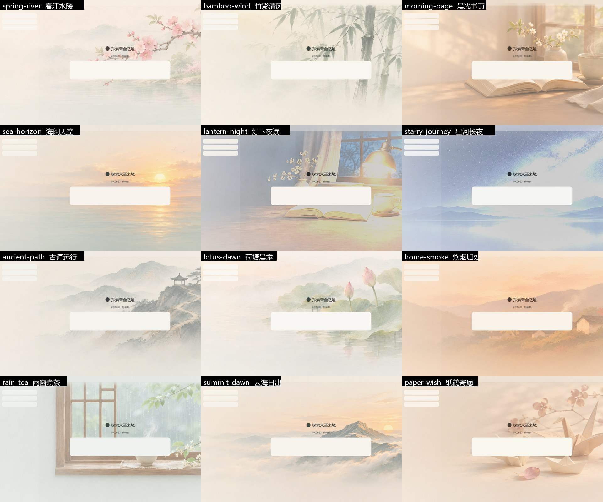
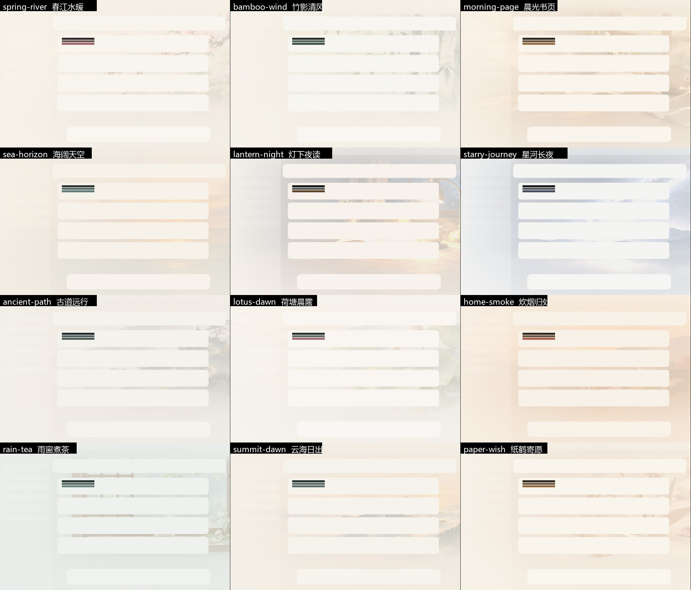
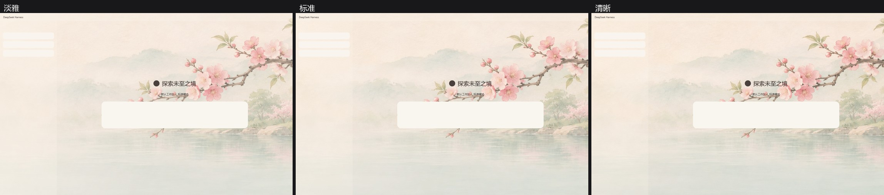

# DSH Theme Studio · 主题工作室

> **20 套原创主题** for DeepSeek Harness（DSH）——水墨、宋瓷、羊皮手稿、月白幽蓝、水彩、色域、暮色油画、银盐光影，以及第二批的春江水暖、竹影清风、晨光书页、海阔天空、灯下夜读、星河长夜、古道远行、荷塘晨露、炊烟归处、雨窗煮茶、云海日出、纸鹤寄愿。
>
> Twenty original literary & artistic themes for [DeepSeek Harness](https://github.com/deepseek-ai). Every theme ships a full light/dark token pair and an animated wallpaper layer.



---

## 特性 Features

- **20 套主题 · 每套 116 个界面令牌**：背景、侧栏、卡片、输入框、代码块、弹窗、滚动条、状态色一整套联动，不是"只换一张壁纸"。
- **浅 / 深双色**：跟随 DSH 原生「外观 → 浅色 / 深色 / 跟随系统」自动切换；每套主题都有对应配套壁纸。
- **动态壁纸**：缓慢推拉（Ken Burns）、光晕呼吸、扫光/纸纹漂移、鼠标视差；尊重系统"减少动态效果"，可一键关闭。
- **背景清晰度三档**：淡雅 / 标准 / 清晰，整体可调且档差均匀，兼顾壁纸细节与文字可读性。
- **可读性优先的界面层**：弹窗、输入框、工具/交付卡、diff、代码块均为不透明纸色，不会透出背后聊天内容（见 `assets/screenshots/surface-bleed-*.png`）。
- **Windows 标题栏一体化**：原生窗口按钮区透明化，符号色跟随主题文字色，与主题标题栏无缝衔接。
- **零第三方美术素材**：20 张主图 + 20 张浅/深配套图均由作者用 AI 生图生成（见 `design/` 里的提示词），代码与主题定义原创，MIT 许可。




## 安装 Install

### 方式 A：GitHub Release 预构建包（当前推荐）

npm 包还在审核/发布流程中，现在请直接用 Release 里的预构建包：

1. 下载：<https://github.com/ruohan0713/dsh-theme-studio/releases/latest/download/dsh-theme-studio-art.tgz>
2. 解压到任意目录，例如 `~/dsh-plugins/dsh-theme-studio-art`。
3. 按下面「方式 B」把该目录 link 进 DSH profile，重启 DSH。

社区目录（awesome-dsh-plugin / dshmarket 的 **Themes** 标签页）已提交收录 PR；合并后也可以直接在 DSH 插件市场里一键安装，不需要 npm。

### 方式 B：手动 link（开发 / 内网）

1. 把本仓库（或 Release 解压目录）放到任意目录，例如 `~/dsh-plugins/dsh-theme-studio-art`。
2. 在 DSH profile 的 `package.json` 依赖中加入：

```json
{
  "dependencies": {
    "dsh-theme-studio-art": "link:C:/path/to/dsh-theme-studio-art"
  }
}
```

3. 在 profile 的 `cordis.patch.yml` 里加入插件行（或直接让插件管理器刷新）：

```yaml
- id: dsh-theme-studio-art
  name: dsh-theme-studio-art
```

4. 重启 DSH。

> 注意：DSH 只加载 profile 内已安装/已链接的客户端插件；直接把文件夹拷到 `node_modules` 而不登记依赖不会被加载。

### 方式 C：npm（暂未上架）

npm 包名计划为 `dsh-theme-studio-art`；上架后可直接用插件管理器安装：

```powershell
npx @deepseek-ai/dsh plugin --profile desktop add dsh-theme-studio-art
```

上架前请不要用这条命令（会 404），用方式 A/B。

## 使用 Usage

- **首页右上角 / 会话头部「主题」按钮**：点击打开主题气泡（20 套缩略图、固定/轮播、背景清晰度）。
- **侧栏底部「主题」行**：任何页面都能打开同一个面板。
- **设置 → 通用 → 主题**：20 个快捷卡片。
- **设置 → 主题工作室**：完整画廊 + 动态壁纸开关 + 背景清晰度 + 壁纸目录说明。

### 背景清晰度

| 档位 | 浅色薄纱 / 内容栏罩 | 深色薄纱 / 内容栏罩 |
|---|---|---|
| 淡雅 | 0.66 / 0.288 | 0.64 / 0.252 |
| 标准（默认） | 0.44 / 0.192 | 0.46 / 0.168 |
| 清晰 | 0.20 / 0.072 | 0.30 / 0.063 |

三档整体上提且档差均匀；越清晰壁纸细节越多，文字对比度相应降低。日常阅读建议「标准」，需要最强可读性用「淡雅」。

## 壁纸 Wallpapers

`wallpapers/` 已包含完整 40 张图：

- 浅色主题：`<id>.jpg` + `<id>-dark.jpg`
- 深色主题：`<id>.jpg` + `<id>-light.jpg`

想换成自己的图：替换 `<id>.jpg` 后重新生成配套变体（仓库不含生成脚本，可按 `design/` 的提示词重新出图），或直接同时提供 `-dark` / `-light` 配套图。**同名 `.jpg` 与 `.png` 同时存在时 PNG 会优先**，换图时先移走旧格式。

主题 id 与中文名：

| id | 名称 | 模式 |
|---|---|---|
| `ink-mist` | 水墨远山 | 浅色 |
| `celadon` | 宋瓷天青 | 浅色 |
| `parchment` | 羊皮手稿 | 浅色 |
| `moonlit` | 月白幽蓝 | 深色 |
| `watercolor-bloom` | 水彩花影 | 浅色 |
| `color-field` | 色域抒情 | 浅色 |
| `oil-dusk` | 暮色油画 | 深色 |
| `silver-film` | 银盐光影 | 深色 |
| `spring-river` | 春江水暖 | 浅色 |
| `bamboo-wind` | 竹影清风 | 浅色 |
| `morning-page` | 晨光书页 | 浅色 |
| `sea-horizon` | 海阔天空 | 浅色 |
| `lantern-night` | 灯下夜读 | 深色 |
| `starry-journey` | 星河长夜 | 深色 |
| `ancient-path` | 古道远行 | 浅色 |
| `lotus-dawn` | 荷塘晨露 | 浅色 |
| `home-smoke` | 炊烟归处 | 浅色 |
| `rain-tea` | 雨窗煮茶 | 浅色 |
| `summit-dawn` | 云海日出 | 浅色 |
| `paper-wish` | 纸鹤寄愿 | 浅色 |

## 兼容性 Compatibility

- DSH 客户端插件 API：`ctx.theme.overrideTokens` + `ctx.slots`（`settings.section` / `settings.general.item` / `conversation.session.header.utilities` / `sidebar.footer.action` / `shell.overlay` / `conversation.hero.options`）。
- 已在 DSH 0.2.x 桌面端（Windows）验证；macOS / Linux 的窗口按钮为系统绘制，本插件的标题栏规则会自动跳过。
- 主题只覆盖颜色/材质令牌与 CSS 层，不修改 DSH 功能逻辑，也不会注入第三方脚本。

## 开发 Development

```bash
node --check client.js
node --check index.js
```

`client.js` 是浏览器端插件包（`window.__ModuleLoader__.load`），`index.js` 是宿主端路由（壁纸清单 + 诊断）。发布前请确认 `package.json` 中的 `dsh.bundle` / `dsh.client` 字段完整。

## 许可 License

- 插件代码、主题定义、配色、CSS 艺术层：**MIT**（见 `LICENSE`）。
- `wallpapers/` 内的图片由作者使用 AI 图像服务生成；使用/再分发前请遵守所使用图像服务的条款，MIT 仅覆盖代码。
- 主题名称与配色为原创，不含任何第三方品牌/系统素材。

---

如果这个主题让 DSH 更舒服一点，欢迎在 GitHub 点个 ⭐，或把截图/建议发到 Issues。
